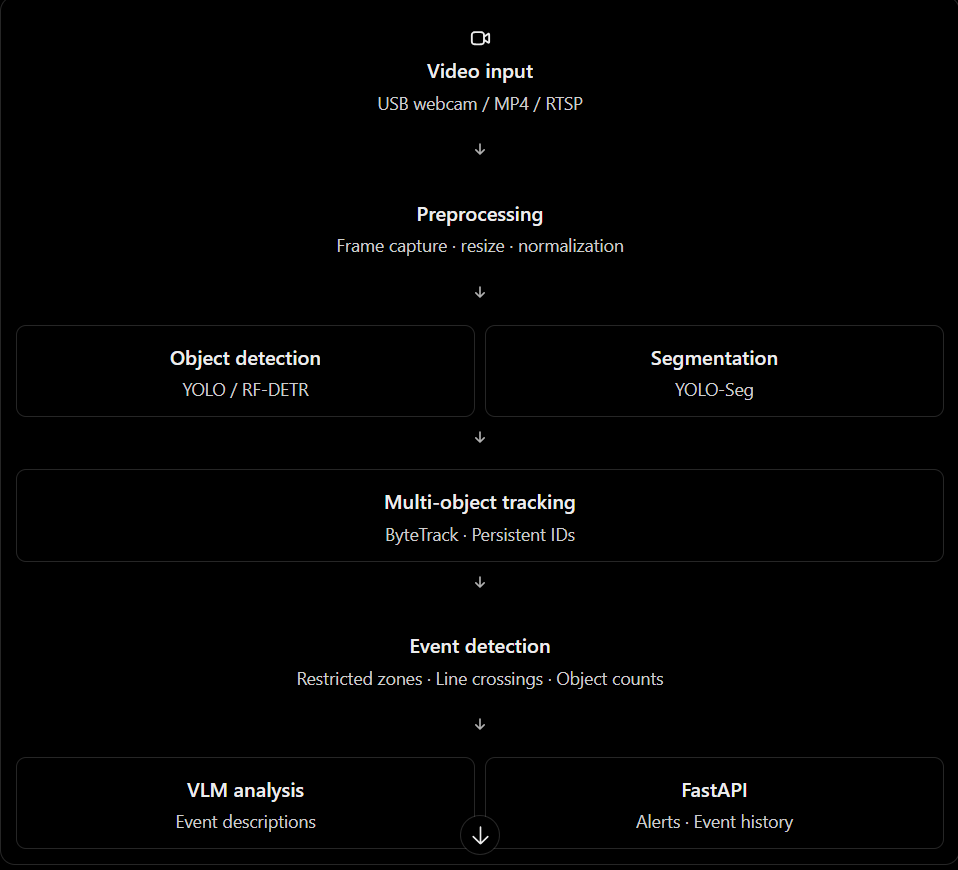
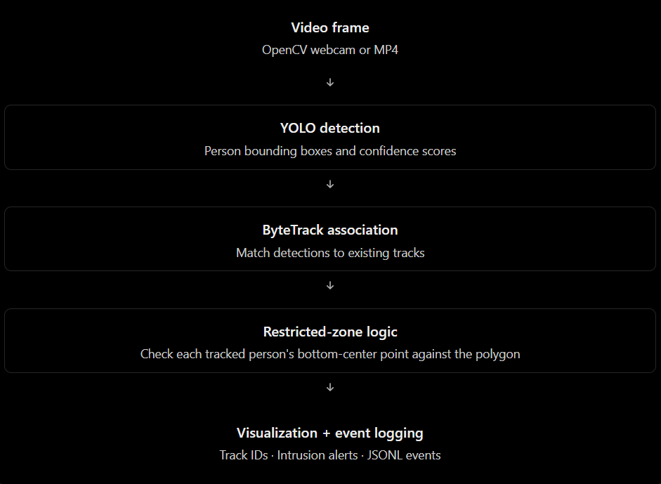
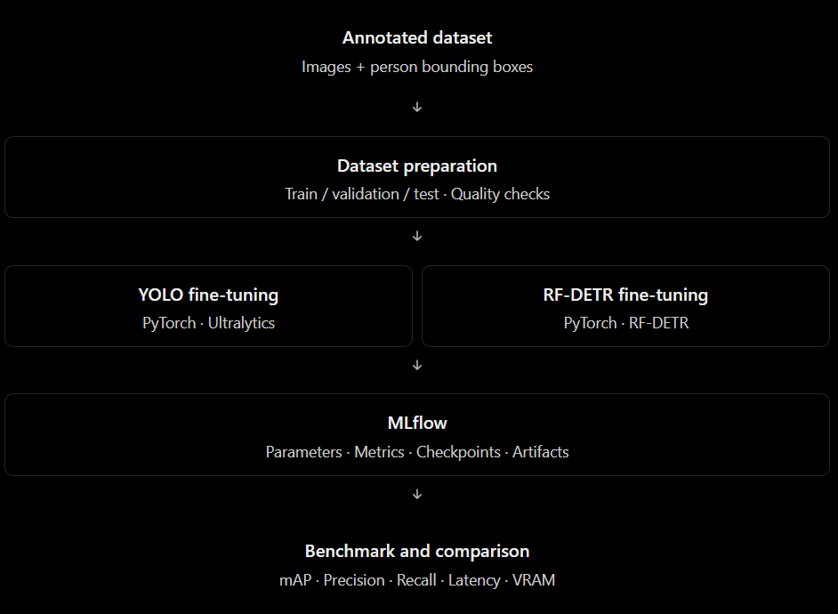
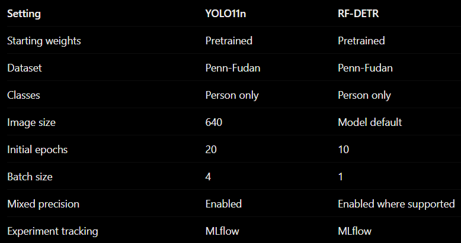

# Intelligent Video Analytics Platform

## Hardware

- Intel i5-13500H
- 16 GB RAM
- RTX 4050, 6 GB VRAM
- CUDA Toolkit 12.6
- NVIDIA driver 566.24

## Planned Tech Stack

- Programming: Python
- Deep Learning: PyTorch
- Object Detection: Ultralytics YOLO, RF-DETR
- Tracking: ByteTrack
- Segmentation: YOLO Segmentation
- Video Processing: OpenCV
- Vision-Language AI: Small Qwen-VL-family model
- Experiment Tracking: MLflow
- Model Export: ONNX, TensorRT
- Backend API: FastAPI
- Dashboard: React + TypeScript
- Containerization: Docker
- Version Control: Git + GitHub

## System Architecture

## How Tracking Works

## Model Training & Evaluation Architecture

## Dataset Strategy

I'm starting with Penn-Fudan Pedestrian, a small, publicly available pedestrian dataset with 170 images and pedestrian annotations.
It's useful for validating the entire training workflow on my RTX 4050 with 6 GB VRAM.
Eventually, I will have to expand later to a larger dataset because this one is too small for a robust production-quality benchmark.
The Penn-Fudan Pedestrian dataset contains 170 pedestrian images with segmentation masks and object-level bounding boxes derivable from the masks. The segmentation masks will be used to derive bouding boxes, then export YOLO and COCO annotations.
Finally, this pedestrian dataset will be split into a deterministic 70/15/15 split, resulting with:

- Training: 118 images, for fine-tuning model weights.
- Validation: 25 images, for selecting checkpoints and tuning hyperparameters.
- Test: 27 images, for final evaluation only.

## Training Plan

Using my NVIDIA RTX 4050 GPU with 6 GM VRAM, I will keep the experiments relatively small:

## Current Limitations

The following limitations need to be addressed after successful development:

- Dataset is small and the split has substantial statistical uncertainty.

## Fixes to be Addressed

The following must be resolved once a stable benchmark has been reached:

- `supervision.ByteTrack` is deprecated in the currently installed version. This dependency should be addressed before any future library upgrades.
  - Console warning: The `ByteTrack` was deprecated since v0.28.0. It will be removed in v0.30.0.
- `torch.jit.script` is deprecated. Need to switch to either `torch.compile` or `torch.export`.
  - Console warning: `torch.jit.script` is deprecated. Please switch to `torch.compile` or `torch.export`.
- RF-DETR: The checkpoint loads successfully, but inference is not optimized.
  - Console warning: rf-detr - Model is not optimized for inference. Latency may be higher than expected. Create predictor = native_model.inference(...) and use predictor.predict(...). For a checkpoint, first load native_model = RFDETR.from_checkpoint(...).
- The `RFDETRLargeDeprecated` was deprecated since v1.7.0. It will be removed in v2.0.0.
- Use a size-specific class such as `RFDETRSmall` instead (see the migration guide).
